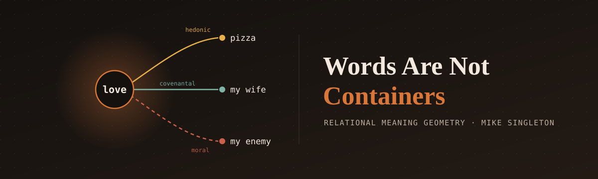
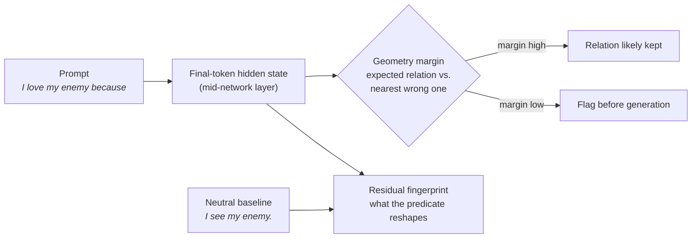

<p align="center">
  
</p>

<p align="center">
  <a href="LICENSE"></a>
  
  
  
</p>

<p align="center"><b>Can you see, inside a language model and before it says a word, whether it understood the relationship?</b></p>

---

## The idea

Most people treat a word like a box with the meaning packed inside. *Love* means love, wherever you put it.

It doesn't work that way. **"I love pizza," "I love my wife,"** and **"I love my enemy"** use the same word for three different relationships. The meaning isn't in the word. It's in the relation between the words.

This project tests whether a language model knows that, and whether you can measure it in the model's hidden states **before it generates anything**. If you can, you get something an engineer can use: a check that runs inside the system and flags when the model has lost the relation the prompt expressed, before the output goes anywhere.

## How RMG works



**Relational Meaning Geometry (RMG)** measures how a predicate (*love, fear, care, hate, own, eat*) reorganizes the model's representation of an object, compared with a neutral predicate (*see*). That difference is the predicate's **fingerprint**:

$$
F_V(c_i, c_j) = \big[D_V(c_i, c_j) - D_{\text{see}}(c_i, c_j)\big] - \mathrm{mean}_{(a,b)}\big[D_V(c_a, c_b) - D_{\text{see}}(c_a, c_b)\big]
$$

The **geometry margin** says how much nearer the prompt's hidden state $x_o$ sits to the class it should express than to the nearest wrong one, with class centroids computed leaving the object out:

$$
m(o) = \min_{c \neq c^\*} \lVert x_o - \mu_c^{(-o)} \rVert - \lVert x_o - \mu_{c^\*}^{(-o)} \rVert
$$

The math is deliberately plain (distances, centroids, permutation tests) so every step can be checked. Full definitions, matched line for line to the scripts: **[docs/METHODS.md](docs/METHODS.md)**.

## What the evidence says

Tested on three model families: Qwen2-7B, Mistral-7B and Gemma-7B.

| Finding | Models | Result |
|:--|:--:|:--|
| Predicates reorganize object geometry beyond chance | 3 of 3 | all 9 verbs, permutation p < 0.001, d = 0.77–1.41 |
| *Fear*'s predicate-specific fingerprint has the same strongest pull | 3 of 3 | companion/hedonic in every model (*care* partial, *love* model-specific) |
| **Geometry predicts whether the output keeps the relation** | 3 of 3 | **AUC 0.778 · 0.700 · 0.668** |
| Idiom vs. literal readings of identical words separate | 3 of 3 | Δ = +0.141 · +0.182 · +0.157, p < 0.0002 |
| Margin direction predicts relation preservation (pilot) | Qwen | 39% vs 14% kept, same model for geometry and output |
| Relation beats possessive syntax (matched pairs) | Qwen | 5 of 5 layers |
| Relation words structure real text (no model at all) | Wikipedia corpus | love / care / like, all p = 0.0002 |
| Sentence encoders under relation flips, scene held constant | Embedding models | leave-one-out accuracy as low as 0.04 |

> [!IMPORTANT]
> The behavioral AUCs are scored by a keyword classifier. A blind human-annotation kit is included and ready to run (no GPU needed). Until it's run, treat those numbers as first-pass.

Every number, caveat and correction is in **[docs/RESULTS.md](docs/RESULTS.md)**. The semiotic results for all three models were recomputed from the row-level generations in `results/` and match the reported figures exactly.

## Quick start

```bash
git clone https://github.com/singleton2787/words-are-not-containers.git
cd words-are-not-containers
pip install -r requirements.txt
huggingface-cli login                      # Gemma-7B is a gated model

python3 run_suite.py --dry-run             # list every step, run nothing
python3 run_suite.py --component corpus    # no GPU, fast
python3 run_suite.py --component ordvec    # quick GPU smoke test
python3 run_suite.py                       # full suite, 6–8 hours on an A10G
```

<details>
<summary><b>All suite components</b></summary>

| Component | What it tests |
|:--|:--|
| `corpus` | Relation structure in Wikipedia text, no model |
| `train` | Relational geometry emerging in a small model trained from scratch |
| `affordance` | Predicate-licensed affordance classes, ablations, likelihood controls |
| `fingerprints` | Predicate fingerprints across Qwen, Mistral, Gemma |
| `semiotic` | Does the geometry margin predict the generated continuation? |
| `idiom` | Idiomatic vs. literal readings of identical phrases |
| `ordvec` | Ordinal Quotient Preservation: does the signal survive rank-only compression? |
| `annotation` | Blind human-annotation export and analysis (run on request) |

Details: [docs/SUITE.md](docs/SUITE.md)
</details>

## Repository map

```
├── run_suite.py          one-command orchestrator
├── scripts/              experiment scripts
├── results/              result files for every reported number
│   └── provenance/       recovered terminal captures
├── corpus/               Wikipedia and WikiText corpora
├── annotation/           blind annotation rubric and training examples
├── paper/                working paper v0.9.3
├── release/              evidence cards (model, dataset, claim-support matrix, risk gaps)
├── legacy/               original and superseded scripts, kept for the record
└── docs/
    ├── METHODS.md        formal definitions of every measurement
    ├── RESULTS.md        every result, number and caveat
    ├── HISTORY.md        from a failed theory to this one
    ├── SUITE.md          how to run and annotate
    ├── ROADMAP.md        what's next and known issues
    └── ACKNOWLEDGMENTS.md
```

## Where this came from

It started with a guitar. When you bend a note on a Strat, the music isn't where you land, it's in the bend. The first version of this project bet that meaning works the same way, living in the curve a sentence traces through a model.

That bet lost. Six curvature metrics, all p > 0.20. What survived the failure is what's in this repo. The full story is in [docs/HISTORY.md](docs/HISTORY.md).

## Cite

```bibtex
@misc{singleton2026wanc,
  title  = {Words Are Not Containers: Relational Meaning Geometry in Language Models},
  author = {Singleton, Mike},
  year   = {2026},
  note   = {Working paper v0.9.3},
  url    = {https://github.com/singleton2787/words-are-not-containers}
}
```

Machine-readable: [CITATION.cff](CITATION.cff)

## Related

- [ogi-math-foundations](https://github.com/singleton2787/ogi-math-foundations): mathematical foundations of the Open General Intelligence framework
- [Headgate](https://github.com/singleton2787/Headgate): OGI Executive Gater implementation
- Dollinger & Singleton (2024), *Creating Scalable AGI: The Open General Intelligence Framework*, [arXiv:2411.15832](https://arxiv.org/abs/2411.15832)

---

<p align="center"><sub>MIT License · © 2026 Mike Singleton · <a href="docs/ACKNOWLEDGMENTS.md">Acknowledgments</a></sub></p>
